<div align="center">


# Coconut Kitchen

**A calm home screen for a spare monitor and a Raspberry Pi.**<br>
Today drawn as a line, the tide behind it, the next trains, and notes from your phone.

[](backend/go.mod)
[](backend/go.mod)
[](#quick-start)
[](#how-it-works)
[](https://github.com/Haugf/coconut-kitchen/commits/main)

[Screenshots](#screenshots) · [Quick start](#quick-start) · [Widgets](#widgets) · [How it works](#how-it-works) · [Settings](#configuration)

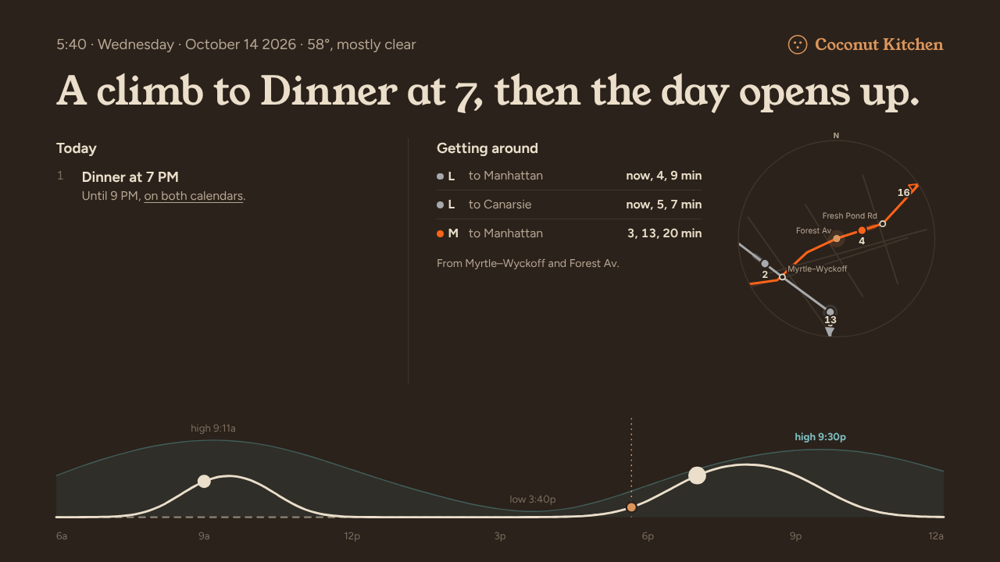

</div>

## Highlights

- **The day as a shape.** Your calendar is drawn as a line from 6 am to midnight, one per person, so you can see a busy evening before you read a word. A plain sentence on top says it in words: *"A climb to Dinner at 7, then the day opens up."*
- **The tide on the same clock.** NOAA predictions sit behind the day line, with the highs and lows marked.
- **Trains on a map.** The next L and M from your stops, plus a small round map with a dot for every train heading your way.
- **Messages from your phone.** `mirror say "Rice is done"`, or the phone page, puts a note on the screen for as long as you choose, and can say it out loud on your Google speaker.
- **Your Google speaker, on screen.** What it's playing (a song, or the station when it's radio) shows in the kitchen, found on the home network with no setup.
- **A settings page, behind a PIN.** Anyone at home can fix their calendar link, switch the look, or set sleep hours from their phone.
- **Two designs, one switch.** Coconut Kitchen and Terrain, swapped with `mirror style`.
- **Looks after itself.** It updates from GitHub within about two minutes of a merge, keeps the last good data when a source fails, sleeps overnight, and reports its own health.

## Screenshots

<table>
  <tr>
    <td width="50%"></td>
    <td width="50%">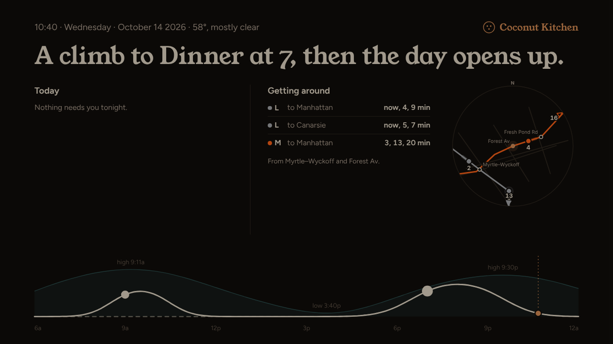</td>
  </tr>
  <tr>
    <td align="center"><sub><b>Coconut Kitchen</b>, day</sub></td>
    <td align="center"><sub>Night: same page, darker and dimmed from 10 pm</sub></td>
  </tr>
  <tr>
    <td width="50%">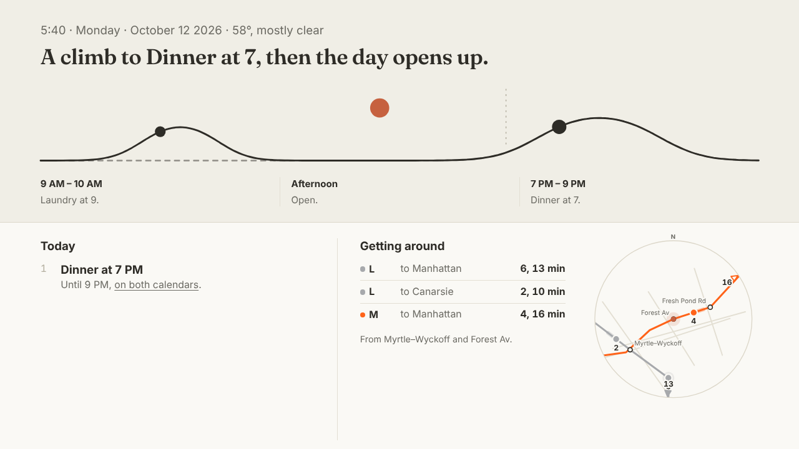</td>
    <td width="50%">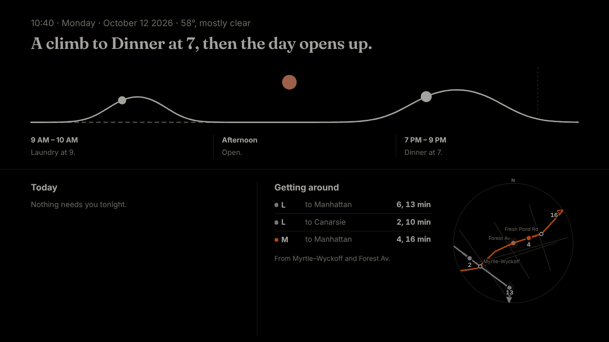</td>
  </tr>
  <tr>
    <td align="center"><sub><b>Terrain</b>, the first design: the day as a ridge</sub></td>
    <td align="center"><sub>Terrain at night</sub></td>
  </tr>
</table>

<table>
  <tr>
    <td align="center" valign="top" width="33%">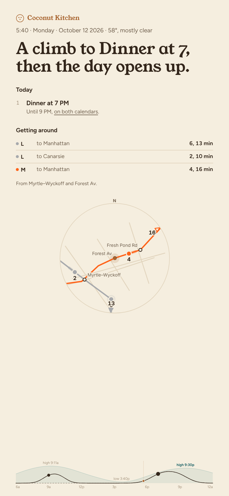</td>
    <td align="center" valign="top" width="33%">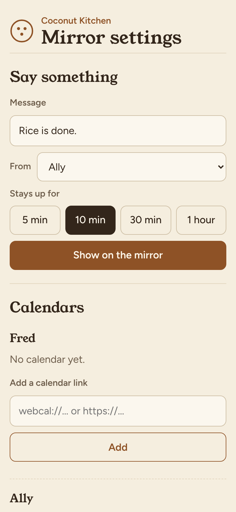</td>
    <td align="center" valign="top" width="33%">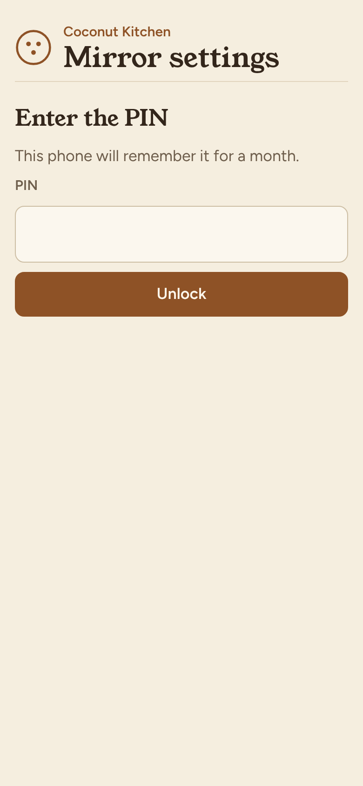</td>
  </tr>
  <tr>
    <td align="center"><sub>The mirror on a phone, at <code>mirror.local:8080</code></sub></td>
    <td align="center"><sub>Settings: send a message</sub></td>
    <td align="center"><sub>Locked with a PIN</sub></td>
  </tr>
</table>

<sub>Screenshots use the sample data in <code>dev/mock_api.py</code>, not anyone's real calendar.</sub>

## At a glance

| | |
|---|---|
| Server | One Go binary, **10.3 MB** for the Pi (arm64), **1** dependency (an iCal parser) |
| Page | **79 KB** of JavaScript and **5 KB** of CSS, gzipped; fonts are bundled, nothing loads from the internet |
| On the Pi | Chromium in kiosk mode and the Go server. No Node, no Electron, no database |
| Merge to wall | About **2 minutes**: the Pi checks GitHub every minute and rebuilds itself |
| Tests | **30** Go tests: tide and transit parsing, sleep, messages, widgets, settings and the PIN, and the Google speaker against a fake one |
| Data sources | Google and iCloud calendars, Open-Meteo, NOAA tides, MTA subway and bus feeds, OpenStreetMap, your Google speaker on the home network. Only the bus feed needs a key |

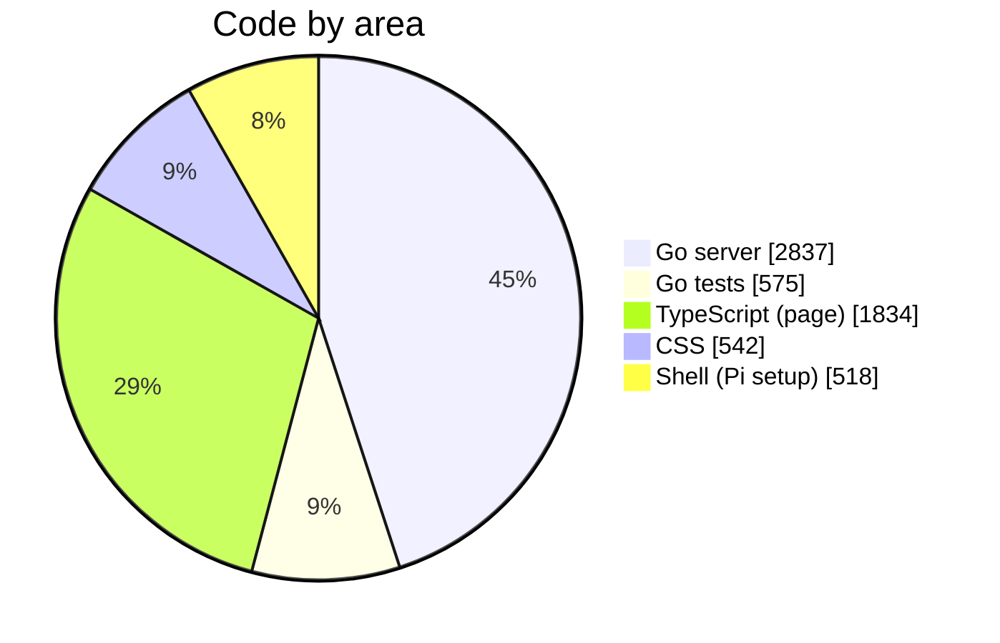

<sub>Non-blank lines per area, October 2026.</sub>

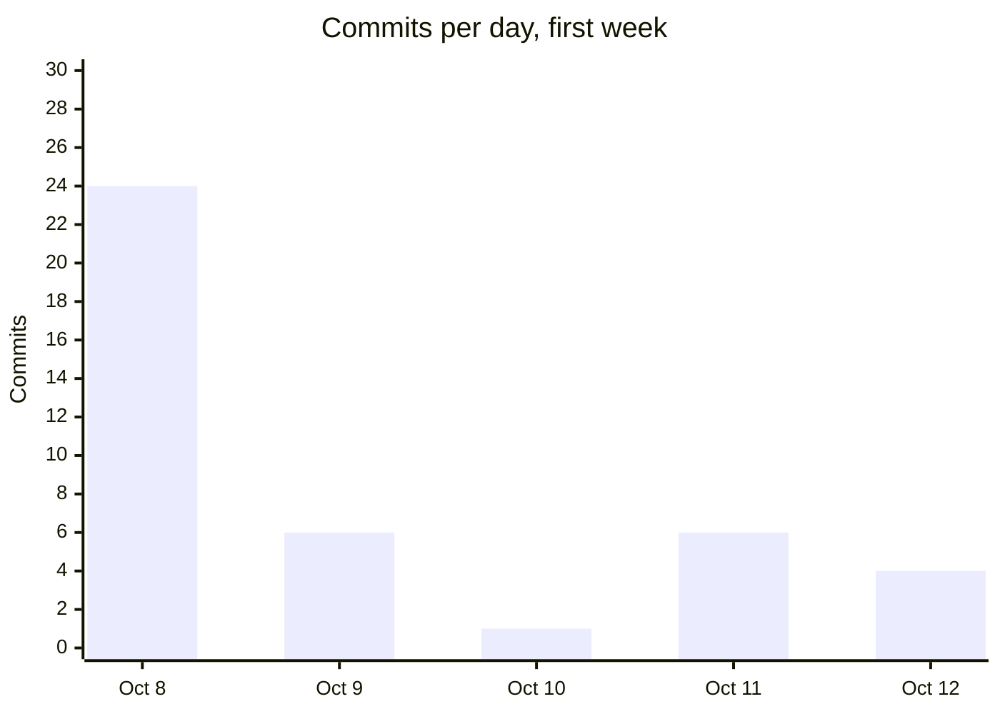

## Quick start

You need a Raspberry Pi 4 on 64-bit Raspberry Pi OS with SSH on, and a monitor.

```sh
curl -fsSL https://raw.githubusercontent.com/Haugf/coconut-kitchen/main/bootstrap.sh | bash
```

That clones to `~/mirror-src`, installs into `~/mirror`, sets up the kiosk and the update timer, and reboots into the mirror. Then:

1. Add your calendar links: `mirror config`, or the phone page below.
2. Set a PIN for the phone page: `mirror pin ABCD`.
3. On your phone, on the home Wi-Fi, open **http://mirror.local:8080/settings**.

No Pi yet? You can see the whole page on your laptop:

```sh
cd frontend && npm install && npm run build
python3 ../dev/mock_api.py            # http://127.0.0.1:8099
python3 ../dev/mock_api.py --style terrain
```

## What's on the screen

| Part | What it shows | Source | Refresh |
|---|---|---|---|
| Date line | Time, weekday, date, weather | Open-Meteo (no key) | 10 min |
| Headline | One observational sentence about the day | Built from the calendar | with calendar |
| Day strip | Along the bottom, 6 am to midnight: the day as a line (Fred solid, Ally dashed), a clay mark at now | Calendar events | with calendar |
| Tide | Behind the day strip on the same clock: the water level, with the day's highs and lows | NOAA predictions (no key) | 1 h |
| Today | Numbered list, with whose calendar each is on | Google (Fred) + iCloud (Ally) | 5 min |
| Tomorrow / In the kitchen / On Kitchen speaker | The latest message while it lasts, else what the Google speaker is playing (song or station, artist, how far along), else tomorrow's events (left out when there are none) | Live messages, the speaker over Cast, calendar | live / 5 s |
| Getting around | L both ways at Myrtle–Wyckoff, M to Manhattan at Forest Av, B13 both ways at Gates/Fairview | MTA GTFS-realtime, MTA Bus Time | 30 s |
| Minimap | A small round map: the M and L, three stations, and a dot for every train or bus heading to your stops, with its minutes. A hollow mark means it hasn't left the start of the line yet | Same feeds, streets from OpenStreetMap | 15 s |
| Night mode | Same page, darker and dimmer | Clock | 10 pm to 5 am |
| Sleep | Screen off (monitor in standby); the Pi keeps running and updating | Clock | 1:00 to 6:30 am |

```mermaid
gantt
    title A day on the mirror
    dateFormat HH:mm
    axisFormat %H:%M
    section Scene
    Night (dark, dim)   :00:00, 5h
    Day (light)         :05:00, 17h
    Night (dark, dim)   :22:00, 2h
    section Day strip
    Drawn hours          :06:00, 18h
    section Rain note
    Shown if rain is due :05:00, 13h
```

The first design, **Terrain** (the day as a ridge in a top band, with three acts), is still there. Switch with `mirror style terrain` and `mirror style kitchen`; the screen follows within a minute.

## Settings from your phone

On the home Wi-Fi, open **http://mirror.local:8080/settings** (or the Pi's IP). You can:

- put a message on the mirror, from whoever is sending it
- check each person's calendar, and add or remove a calendar link (the page shows only which site a link points to, never the secret address)
- switch between Coconut Kitchen and Terrain
- turn the screen off or on now, and set the sleep hours

It's locked with a PIN that lives only in `config.json` on the Pi, never in this public repo. Set it with `mirror pin ABCD`; letters or numbers, and case doesn't matter. Each phone remembers it for a month, changing the PIN signs every phone out, and five wrong tries lock the page for a minute.

Saving a change rewrites `config.json`, keeping everything else in it, and restarts the server, so the screen catches up within a few seconds. The page only answers on the home network.

## Widgets

Everything beside Today is a widget: a folder in `frontend/src/widgets/` with a `widget.json`, found automatically. Each widget declares its settings and the web addresses it reads; the Pi fetches and caches those, so a widget never needs its own server. Choose which ones show, and in what order, with the `widgets` list in `config.json`.

```sh
cd frontend
npm run new-widget -- plant-water     # copies the template
npm run build                         # runs the widget check first
python3 ../dev/mock_api.py --with plant-water
```

You don't need a Pi to build one. [WIDGETS.md](WIDGETS.md) covers the manifest, the look (it restyles itself for day, night and both designs), and how to open a pull request.

## How it works

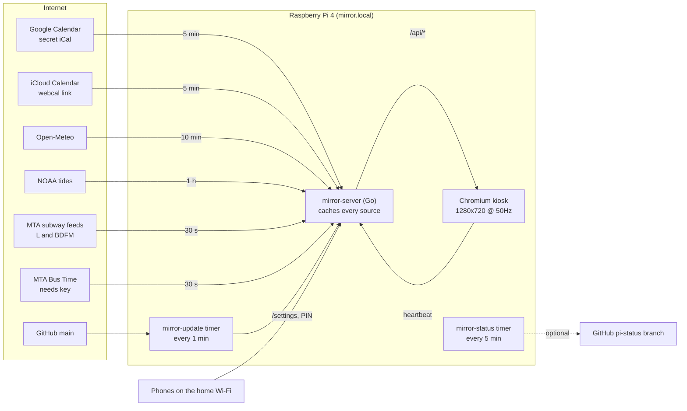

Each source sits behind a small cache. If a fetch fails, the screen keeps the last good answer and `/api/status` records the error, so one broken calendar never blanks the other.

<details>
<summary><b>How an update reaches the Pi</b></summary>

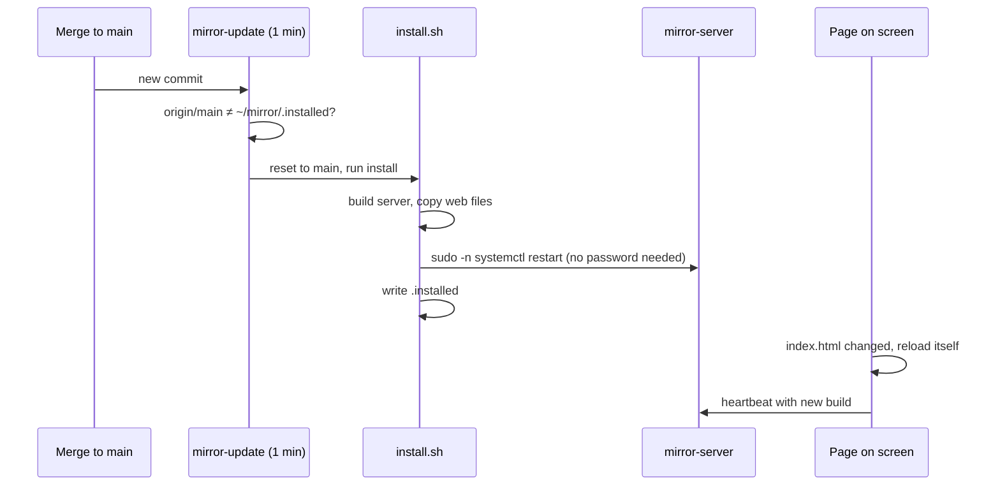

The frontend is prebuilt in `frontend/dist`, so the Pi never needs Node. If an install fails, `.installed` isn't written and the next minute tries again.

</details>

## Running it

### The `mirror` command

Everyday chores, from any SSH session on the Pi:

| Do this | Command |
|---|---|
| Check everything | `mirror status` |
| Screen off / on now | `mirror off`, `mirror on` |
| See or set sleep hours | `mirror sleep`, `mirror sleep 00:30 07:00`, `mirror sleep never` |
| Put a message on screen | `mirror say "Laundry is done" 15` |
| Switch page style | `mirror style terrain`, `mirror style kitchen` (plain `mirror style` shows which is on) |
| Set the settings page PIN | `mirror pin ABCD` (plain `mirror pin` says whether one is set) |
| Centre the minimap on home | `mirror home "your address"` |
| Update now instead of waiting | `mirror update` |
| Restart, follow the log | `mirror restart`, `mirror logs` |
| Edit settings safely | `mirror config` (restarts only if the JSON is valid) |

It's installed with every update. If the shell says `mirror: command not found` the first time, log out and back in (or run `~/mirror/mirror.sh`).

### Checking on it

```
$ mirror status
✓ Server running
✓ Browser on screen
✓ Page checking in            seen 12s ago
✓ Screen shows the installed build
✓ Up to date with GitHub
✓ Last auto-update            success
✓ Calendars                   Fred 6, Ally 2
✓ Weather
✓ L to Manhattan              3, 11, 19 min
✓ L to Canarsie               5, 14 min
✓ M to Manhattan              7, 19 min
✓ Transit visible on screen   3 rows
✓ Power                       throttled=0x0, 48.2°C
```

`mirror status --json` gives the same as JSON. To have the Pi publish it every 5 minutes, so it can be read without SSH, run `bash ~/mirror/report-setup.sh` once. It makes a deploy key for the repo; reports go to the `pi-status` branch and hold counts and health only, never event titles, calendar links or keys.

## Configuration

Everything lives in `~/mirror/config.json` on the Pi. It's never committed: treat calendar links, keys and the PIN like passwords.

<details>
<summary><b>An example <code>config.json</code></b></summary>

```json
{
  "style": "kitchen",
  "weather": { "latitude": 40.7044, "longitude": -73.9018 },
  "calendar": {
    "people": [
      { "name": "Fred", "icsUrls": ["https://calendar.google.com/…/basic.ics"] },
      { "name": "Ally", "icsUrls": ["webcal://p…-caldav.icloud.com/published/2/…"] }
    ]
  },
  "tides": { "station": "8518750", "place": "The Battery" },
  "map": { "home": { "address": "your street address" } },
  "transit": {
    "busApiKey": "",
    "bus": [
      { "route": "B13", "stopCode": "", "label": "Ridgewood", "stopName": "Gates Av / Fairview Av" },
      { "route": "B13", "stopCode": "", "label": "Crescent St", "stopName": "Gates Av / Fairview Av" }
    ]
  }
}
```

</details>

- **Google calendar:** Google Calendar on the web › Settings › the calendar › "Secret address in iCal format".
- **iCloud calendar:** iPhone Calendar › Calendars › (i) next to the calendar your events go in › Public Calendar › Share Link. Calendars stored "On My iPhone" can't be shared.
- **Tide:** any NOAA tide station id works (search tidesandcurrents.noaa.gov); `"station": ""` turns it off.
- **Google speaker:** the Pi finds Google speakers on the home network by itself. `"cast": {"name": "Kitchen speaker"}` picks one by its name in the Google Home app (without it, the first that answers); `"host"` pins an address if discovery doesn't work on your network; `"off": true` turns it off. Spoken messages use Google Translate's voice, so their text goes to Google, and saying one stops whatever the speaker was playing.
- **Sleep hours:** `"sleep": {"from": "01:00", "to": "06:30"}`; set both to `""` to stay on all night.
- **Minimap:** put your address under `map.home.address`. The Pi looks it up once and keeps it in `~/mirror/map-home.json`. Trains are placed between stations from their arrival times (the subway feed has no GPS); buses are real GPS once the Bus Time key is in.
- **B13:** a free key from register.developer.obanyc.com, plus the two stop codes from bustime.mta.info. The subway rows need no key.

### Live messages from anything

Anything on the home network can put text on the mirror:

```sh
curl -X POST http://mirror.local:8080/api/events \
  -H 'Content-Type: application/json' \
  -d '{"text":"Laundry is done","source":"Home","ttl":30}'
```

Add `"speak": true` to say it out loud on the Google speaker too.

Set `eventsToken` in `config.json` to require `Authorization: Bearer <token>`.

## Coming from MagicMirror²?

[MagicMirror²](https://github.com/MagicMirrorOrg/MagicMirror) made this kind of project a hobby, and its module ecosystem is far bigger than anything here. Coconut Kitchen is narrower on purpose: one designed page rather than a grid of modules, a single Go binary and a prebuilt page instead of an Electron app, and widgets that inherit the page's look so new ones fit in without styling. If you want hundreds of modules, MagicMirror² is the place. If you want one quiet screen that runs itself, try this.

## Contributing

The Pi runs whatever is on `main`, so `main` only takes pull requests, and only the maintainer merges (a GitHub ruleset blocks direct and force pushes). Agents and helpers push branches and open pull requests.

- New things should usually be a [widget](WIDGETS.md); they never touch core files.
- Before a pull request: `cd backend && go vet ./... && go test ./...` and `cd frontend && npx tsc --noEmit -p . && npm run build`, then commit the rebuilt `frontend/dist` (the Pi has no Node).
- [AGENTS.md](AGENTS.md) has the full house rules: privacy (this repo is public), design, and the Pi's limits.

<details>
<summary><b>Repo layout</b></summary>

```
backend/    Go server: calendar, weather, tides, transit (hand-rolled GTFS-rt parser),
            the Google speaker (Cast, mDNS), settings API, status
frontend/   Vite + React + TypeScript
            src/widgets/kitchen/   the Coconut Kitchen page
            src/widgets/terrain/   the Terrain page and the parts both share
            src/widgets/<id>/      one folder per widget
            src/settings/          the phone page at /settings
            dist/                  the committed build the Pi serves
deploy/     setup-pi.sh, mirror.sh, mirror-status.sh, push-status.sh, report-setup.sh
dev/        mock_api.py: the whole page with sample data, no Pi needed
bootstrap.sh, install.sh, update.sh
```

</details>
